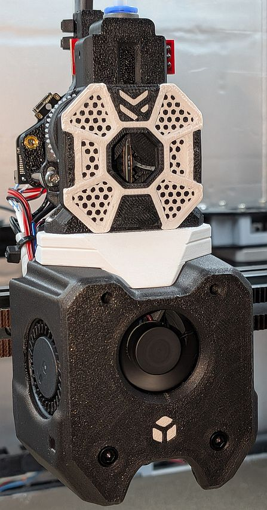

# Mods in this folder

## Cheap Nylon Drive Gears Mod

 

There's these cheap nylon modulus 0.5 441225A gears that are a few dollars for a bag of ten on AliExpress, but as the model number implies I only found them with a 2.5 mm center, not the 3.0 mm we need.

Use the jig and a 3.0 mm reamer to get a 3.0 mm center; assemble the jig with 4x M5x20 FHCS and hex nuts. 

The thickness of the 12 and 44 teeth gears are different from the stock metals parts but the modified pulleys compensate for this; depending on your parts' tolerances you might need to remove some material from the top of the first stage gear so it does not interfere.

## Optical Runout Sensor Mount

A modified top shell that accomodates a small "bar style" 5V optical sensor board, use 2x M3x4x5 brass threaded inserts and 2x M3x8 BHCS. **Install last** as it will block the screw attaching the two shells on top.

## A4T EBB 36 (Gen 1) Toolhead Board Mount

%20Toolhead%20Board%20Mount/EBB36_mount.jpg)

A different style of mount, use 20 mm M3 standoffs, 1x M3x16, 3x M3x8, 1x M3x4x5 threaded brass insert. Use with `User_Mods/cobre/A4T Extruder Adapters/STL/a4t-papilio-adapter-xol-carriage.stl` (or the Voron logo variant).

## Assorted notes

- Use DIN 557 square nuts instead of hex nuts, they're much less liable to cam out.
- On A4T, the PTFE tube between the extruder and hotend should measure approx 31 mm.
- I put a bit of white lithium grease on my gears.

